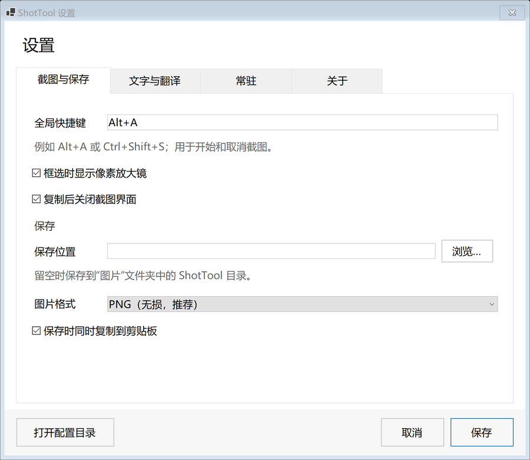
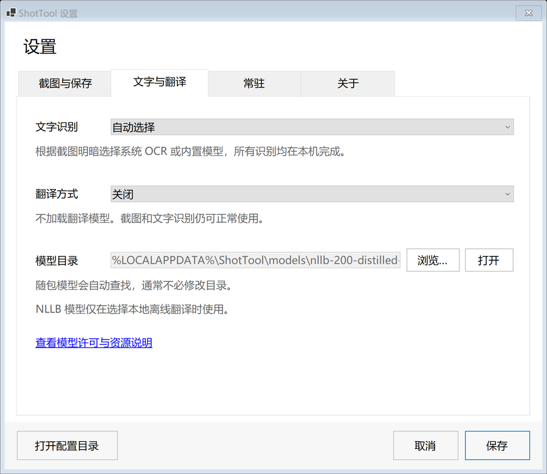

# ShotTool

Windows 上的独立截图工具，参考微信截图的常用交互。**无需启动微信，也无需登录账号。**

支持窗口自动识别与框选、标注、复制、保存、固定截图、全局快捷键和托盘常驻。提供系统 OCR、可选 Paddle OCR，以及可选本地离线翻译。

## 使用

从 [Releases](https://github.com/cuppur/ShotTool/releases) 获取 Windows x64 程序，双击后按 **Alt+A** 截图。

- 拖拽框选，选择矩形、椭圆、箭头、画笔、马赛克、文字或序号工具。
- 鼠标悬停窗口时预览窗口边界，单击锁定；按住并拖动仍可手动框选。
- 预览时滚轮向下选择可识别的原生子控件、向上返回整窗；按住 Shift 临时关闭吸附。锁定后方向键移动 1 像素，Shift+方向键移动 10 像素（未选绘图工具时）。
- **Enter / Ctrl+C** 复制，**Ctrl+S** 保存，**Esc / 右键** 取消。
- 点击图钉或在截图窗口按 **F3** 固定截图。贴图支持拖动、滚轮缩放、双击恢复、复制、另存为和关闭。
- 托盘右键 → 设置，可修改热键、保存位置、识别与翻译方式、开机启动。

Windows 10 2004+ / Windows 11，x64。标准发布为自包含程序，无需安装 .NET。程序未签名。


## 设置界面

设置按“截图与保存、文字与翻译、常驻、关于”分页，保存和取消固定在底部。布局检查覆盖 100%、150%、225% 缩放与最小窗口尺寸。





截图来自自建测试配置的真实控件渲染，不含用户桌面内容。

## 从源码构建

需要 Windows 和 .NET 8 或更新 SDK：

```powershell
./scripts/build.ps1
```

源码不含模型权重；不下载模型也可以编译，使用系统 OCR。要在程序中内嵌 Paddle OCR：

```powershell
./scripts/fetch-ocr-models.ps1
./scripts/publish.ps1 -Version 0.7.0
```

OCR 下载脚本会校验固定 SHA-256。发布目录为 `dist/ShotTool-0.6.0-win-x64/`。构建过程需要还原 NuGet 依赖。

翻译默认关闭，需自行准备模型或本机 Ollama 服务。标准发布包不含约 1.1 GB 的 NLLB 权重；启用方法和所需文件见 [使用说明](docs/usage.md)。

## 范围与限制

窗口识别按截图开始时的可见窗口层级进行，优先采用 DWM 边框，过滤隐藏、最小化、其他虚拟桌面及透明穿透窗口；可选择有原生 HWND 的内部控件。浏览器网页卡片、图片与自绘区域不保证单独识别，窗口被遮挡的部分不会还原。识别边界采用物理像素，多屏混合 DPI 仍需更多实机验证。

当前没有长截图、自动敏感信息打码、水印、表情和微信联系人分享；已有标注不支持逐个选中重编辑。界面参考微信，但不是原生模块独立化，也不承诺逐像素一致。与微信、飞书的范围比较见 [窗口识别与功能范围](docs/window-selection.md)。

OCR 和翻译效果随内容变化。多显示器混合 DPI、HDR、独占游戏及受保护画面尚待更多实机验证。贴图不跨程序重启恢复。

## 组件与许可

本项目不包含或分发腾讯二进制组件、图标或模型。系统 OCR、Paddle OCR 和本地翻译不需要发送截图到远端服务。

第三方组件保留各自许可，详见 [licenses](licenses/)。PaddleOCR 模型与相关组件的声明随程序分发。可选 NLLB 模型的上游许可为 CC-BY-NC-4.0，限非商业用途并需署名，模型许可独立于程序代码。

当前仅公开源代码，**尚未为本项目自研代码指定开放源码许可证**；不能将第三方组件许可证视为整个项目的许可证。

更多信息：[使用说明](docs/usage.md) · [架构与构建](docs/architecture.md)。
